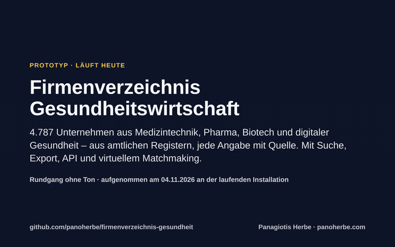
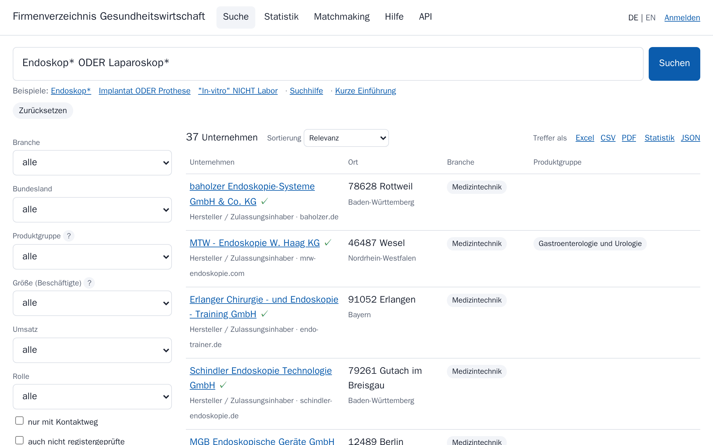
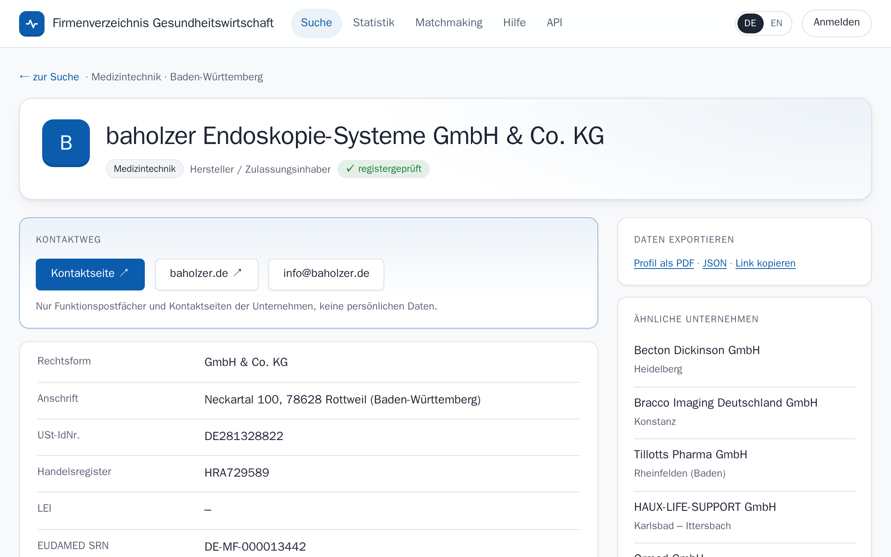
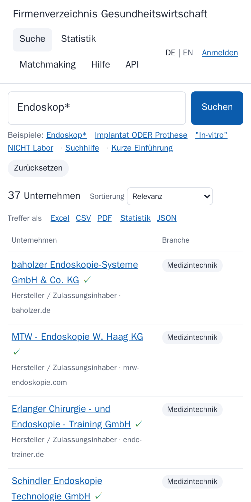
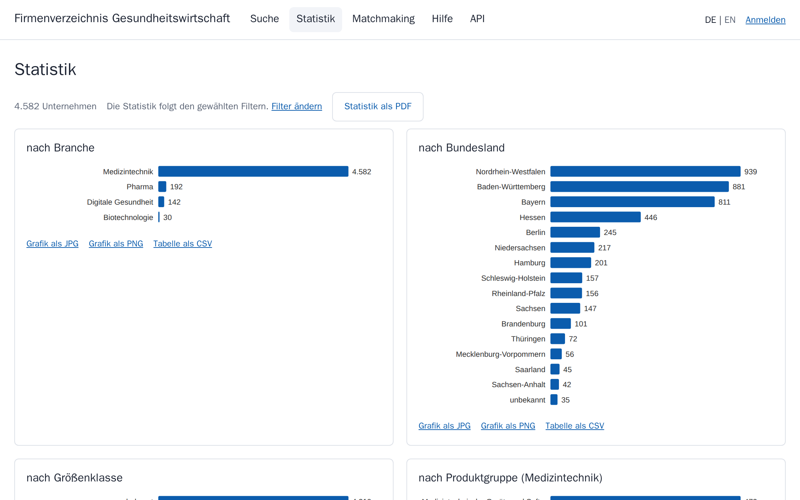
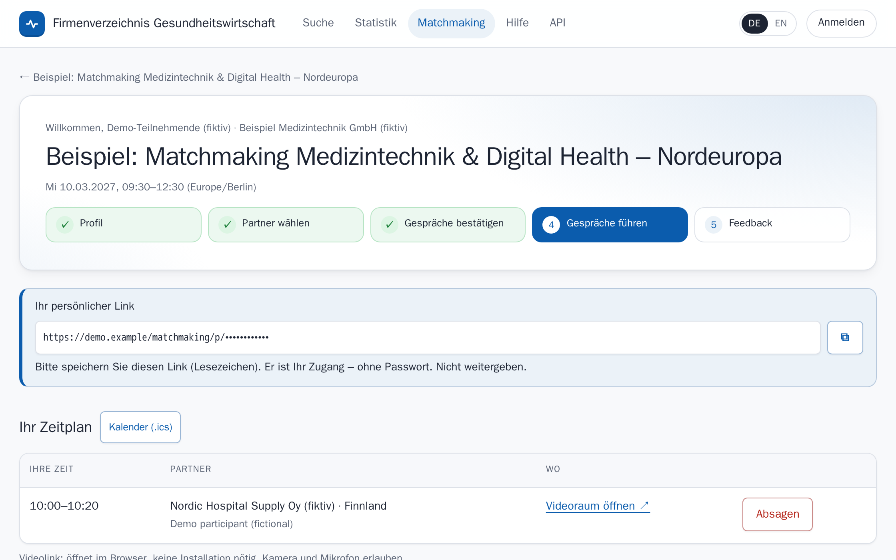
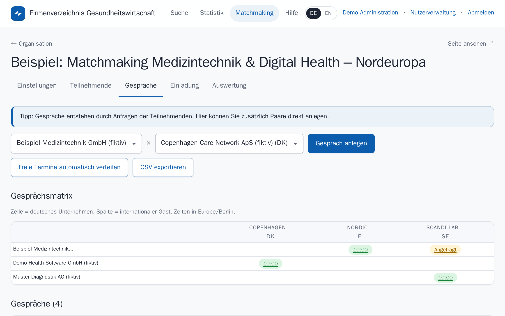

# Firmenverzeichnis Gesundheitswirtschaft

**Ein Verzeichnis der deutschen Gesundheitswirtschaft, das sich selbst pflegt:** Medizintechnik, Pharma,
Biotechnologie und digitale Gesundheit, gebaut aus amtlichen Registern. Jede Angabe nennt ihre Quelle. Dazu gibt es
Suche, Export, API und virtuelles Matchmaking mit internationalen Partnern. Es läuft heute; die Zahlen unten sind
an der laufenden Installation gemessen.



▶ **[Rundgang als Video (MP4, ohne Ton, mit Untertiteln)](medien/rundgang.mp4)**

## Was es für Sie tut

- **Ausländische Interessenten finden deutsche Hersteller.** Sie suchen nach Produkt, Ort oder Firma, filtern nach
  Branche, Bundesland, Produktgruppe und Größe und kommen mit zwei Klicks zur Kontaktseite. Das geht auf Deutsch und
  Englisch, am Rechner und auf dem Telefon.
- **Ihr Team arbeitet mit den Daten.** Suchen lassen sich speichern, der Verlauf bleibt erhalten. Excel, CSV und PDF
  gehen in einem Klick heraus, Diagramme als JPG oder PNG für Präsentationen. Eine API liefert dieselben Daten
  automatisch.
- **Sie bringen Firmen ins Gespräch.** Das virtuelle oder hybride Matchmaking macht Vorschläge mit Begründung, plant
  die Termine automatisch, öffnet Videoräume und wertet am Ende eine Umfrage zu Nutzen und Umsatzchancen aus.
- **Datenschutz ist eingebaut.** Im Verzeichnis gibt es keine Personendaten: nur Unternehmen, Kontaktseiten und
  Funktionspostfächer, keine gekauften Listen. Matchmaking, Nutzerkonten und Support speichern Name, Funktion und
  E-Mail-Adresse mit Einwilligung bzw. auf Vertragsgrundlage und mit Löschfrist (Matchmaking: 12 Monate nach der
  Veranstaltung).

| Suche mit Filtern | Profil mit Quellen | Auf dem Telefon |
|---|---|---|
|  |  |  |

| Statistik und Export | Matchmaking: persönliche Agenda | Matchmaking: Veranstalter |
|---|---|---|
|  |  |  |

## Was Sie brauchen → läuft hier schon

Gemessen am 05.11.2026 an der laufenden Installation; Abfragen und Ausgaben: [`nachweis/2026-11-05/`](nachweis/2026-11-05/).

| Was Sie brauchen | Stand |
|---|---|
| ein großer, geprüfter Bestand | **4.787 registergeprüfte Unternehmen** (EUDAMED, EMA, LEI), 9.744 insgesamt suchbar |
| ein Kontaktweg zu jedem Unternehmen | **4.144** davon mit Funktionspostfach oder Kontakt-/Impressumsseite, 222 nur mit Website, 421 noch ohne; im Verzeichnis keine Personendaten |
| was die Firma macht und herstellt | Branche mit Begründung; Produktkennung für 2.013 Firmen: Produktgruppen nach EU-Nomenklatur (EMDN) aus EUDAMED für 1.734, Arzneimittel aus EMA für 331 |
| schnell das Richtige finden | Volltextsuche mit UND/ODER/NICHT, Klammern, Phrasen, Wortanfang; Filter Branche, Bundesland, Produktgruppe, Größe, Umsatz, Rolle |
| im Team arbeiten | namentliche Konten, gespeicherte Suchen und Suchverlauf, Admins mit zweitem Faktor (TOTP), Zugriffsprotokoll |
| Daten und Grafiken weiterverwenden | Excel, CSV, PDF, JSON, Diagramme als JPG/PNG, REST-API mit englischer Dokumentation |
| internationales Publikum | Oberfläche und Profile auf Deutsch und Englisch |
| in die eigene Website einbetten | `?embed=1`, Farben, Schrift und Logo per Theme-Datei |
| Geschäftskontakte anbahnen | Matchmaking eingebaut; internationale Firmenbasis mit **6.450 Unternehmen aus 80 Ländern** (EMA, CORDIS) |
| verlässlicher Betrieb | Ticketformular mit sofortiger Ticketnummer, Statusseite, monatlicher SLA-Bericht; tägliche Backups mit Wiederherstellungstest und Kopie an einen zweiten Standort (Skripte in `ops/`; auf der Demo laufen Backup, Wiederherstellungstest und Selbstprüfung) |

## In zwei Minuten selbst prüfen

1. Demo öffnen: **[firmen.panoherbe.com](https://firmen.panoherbe.com)** (Testzugang für gespeicherte Suchen auf Anfrage: kontakt@panoherbe.com).
2. „Endoskop*“ suchen, links „Baden-Württemberg“ wählen und ein Profil öffnen.
3. Oben rechts auf **EN** schalten.
4. Über „Statistik“ ein Diagramm als JPG herunterladen.
5. Unter „Matchmaking“ die Beispielveranstaltung öffnen. Sie ist fiktiv, die Teilnehmenden sind erfunden.

## Ehrliche Grenzen

- **Größenklassen** (Beschäftigte) gibt es heute für 422 registergeprüfte Firmen (9 %). Die Zahlen sind Angaben
  der Firmen auf ihrer eigenen Website. Eine Stichprobe von 30 war in 27 Fällen richtig. **Umsatzklassen** fehlen
  fast ganz.
- **Biotechnologie und digitale Gesundheit** sind dünn besetzt, weil es für beide kein Pflichtregister gibt.
  Verbandslisten übernehmen wir bewusst nicht (Datenbankherstellerrecht).
- **Bevollmächtigte und Importeure** gehören nicht immer zur Branche. In einer Stichprobe vom 02.11.2026 waren es 15 von 20 (nachgezählt gegen den heutigen Stand: 14 von 19, siehe `nachweis/`). **421** registergeprüfte Firmen haben noch keinen Kontaktweg und 222 nur eine Website; sie werden bei jeder Aktualisierung neu gesucht..
- Die internationale Firmenbasis enthält nur Unternehmen aus EU-Registern. Gewonnen werden Teilnehmende über
  Einladungen mit Einwilligung, nie über Kalt-E-Mails.
- Prototyp, betrieben von einer Person. Der Betrieb ist automatisiert (Monitoring, Neustart, Backups, Standby);
  auf der Demo laufen Neustart, tägliches Backup und Wiederherstellungstest, ein Standby-Server noch nicht.
  Störungen der Priorität 1 gehen als Alarm aufs Telefon.
- Videoräume für Matchmaking-Gespräche laufen in der Demo über meet.jit.si (Drittanbieter); für den Betrieb ist ein
  eigener Jitsi-Server vorgesehen.

## Text des Rundgangs

Das Video hat keinen Ton; die Untertitel stehen hier zum Nachlesen (58 Sekunden, Karten verkürzt).

- **0:00** Prototyp · läuft heute Firmenverzeichnis Gesundheitswirtschaft 4.787 Unternehmen aus Medizintechnik, Pharma, Biotech und digitaler Gesundheit – aus amtlichen …
- **0:04** Ein Suchfeld für alles: Produkt, Firma, Ort, Postleitzahl oder Registernummer.
- **0:09** UND, ODER, NICHT, Klammern und Wortanfänge funktionieren – auf Deutsch und Englisch.
- **0:12** Filter lassen sich kombinieren; die Zahl in Klammern zeigt vorher, wie viele Treffer bleiben.
- **0:15** Zwei Klicks bis zum Profil: Kontaktseite, Produkte nach EU-Nomenklatur, Register- und Steuernummern.
- **0:19** Jede Angabe nennt ihre Quelle und Lizenz. Im Verzeichnis keine Personendaten: nur Funktionspostfächer und Kontaktseiten.
- **0:23** Dasselbe Profil auf Englisch – für Interessenten im Ausland. Oberfläche und Profile sind zweisprachig.
- **0:26** Statistik zur aktuellen Auswahl. Jede Grafik geht als JPG oder PNG heraus, die Seite als PDF, die Trefferliste als Excel, CSV oder PDF.
- **0:30** Namentliche Konten für das Team, Administratoren mit zweitem Faktor.
- **0:31** Suchen mit allen Filtern speichern und wieder aufrufen; der Suchverlauf ist immer da.
- **0:34** Virtuelles Matchmaking: Veranstaltungsseite mit Programm und Anmeldung, hier ein fiktives Beispiel.
- **0:38** Jede teilnehmende Firma bekommt Vorschläge mit Begründung, fragt Gespräche an, und der Termin wird automatisch eingeplant – mit Videoraum und Kalenderdatei.
- **0:42** Die Veranstalterin sieht Anmeldungen, Gespräche und nach der Veranstaltung die Umfrage zu Zufriedenheit, Nutzen und Umsatzchancen.
- **0:46** Mobil Auf dem Telefon Dieselbe Suche im Browser des Telefons. Einbettung per iframe in jede Website, Farben und Logo nach Corporate Design. …
- **0:49** Gemessen am 05.11.2026 Was heute schon läuft 4.787 registergeprüfte Unternehmen (EUDAMED, EMA, LEI) 4.144 davon mit Funktionspostfach oder …
- **0:54** Selbst prüfen In zwei Minuten ausprobieren Demo öffnen, „Endoskop*“ suchen, ein Profil öffnen, oben auf EN schalten. Quellcode offen, AGPL-3.0. …

---

## Technik

- **Quellen** (Rohablage vor dem Einlesen unter `raw/<quelle>/<tag>/`, Postgres hält nur Pfad und SHA-256):
  EUDAMED-Akteure und -Produkte (EU-Kommission), EMA Article-57-Daten, GLEIF Golden Copy (CC0), CORDIS (CC BY 4.0),
  Zuschläge öffentlicher Aufträge (TED, Bekanntmachungsservice), Websites der Firmen (nur Kontaktseite, Erreichbarkeit
  und Beschäftigtenzahl; robots.txt wird beachtet, § 44b UrhG).
- **Datenlizenzen:** EUDAMED, TED und CORDIS: Europäische Kommission bzw. Union, Weiterverwendung nach Beschluss
  2011/833/EU (CC BY 4.0, Quellenangabe, Änderungen kenntlich). EMA: Vervielfältigung erlaubt mit der Angabe
  „Source: European Medicines Agency“. GLEIF: CC0. oeffentlichevergabe.de: amtliche Bekanntmachungen, genutzt werden
  nur Firmenname und Zuschlagsdaten. Die Anwendung nennt die Quelle je Eintrag (`/quellen`, „Herkunft der Daten“).
- **Keine Personendaten im Verzeichnis:** Die verantwortliche Person aus EUDAMED (PRRC) wird vor dem Schreiben entfernt. E-Mail-Adressen
  bleiben nur, wenn sie Funktionspostfächer sind. Einzelkaufleute, Apotheken und Namen ohne Rechtsform fliegen raus.
- **Entity Resolution ohne Ähnlichkeitswerte:** nur exakte Schlüssel (USt-IdNr., Handelsregister + PLZ-Region,
  Name + Ort, LEI). Jede Verknüpfung speichert ihre Regel.
- **Anwendung:** FastAPI, serverseitig gerendert, ohne fremde Skripte oder CDNs; `web/app.py` (Suche, Statistik,
  Export, API), `web/auth.py` (Konten, TOTP, Protokoll), `web/matchmaking.py`, `web/support.py`.
- **Betrieb:** `ops/` mit Bootstrap für Ubuntu 24.04, Caddy (TLS), systemd-Timern für Backup, Wiederherstellungstest,
  Monitoring, Datenaktualisierung und SLA-Bericht.

```bash
cp .env.example .env            # Zugangsdaten eintragen
python -m venv .venv && .venv/bin/pip install -r requirements.txt
docker run -d --name firmen-db -e POSTGRES_USER=firmen -e POSTGRES_DB=firmen -e POSTGRES_PASSWORD=... \
  -p 127.0.0.1:5434:5432 postgres:16
.venv/bin/python -m etl.load schema && .venv/bin/python -m ops.schema
.venv/bin/python -m etl.sources.eudamed fetch     # mehrere Stunden: die API ist langsam und drosselt
.venv/bin/python -m etl.sources.ema fetch
.venv/bin/python -m etl.sources.gleif fetch       # ~500 MB
.venv/bin/python -m etl.load all && .venv/bin/python -m etl.resolve
.venv/bin/python -m etl.sources.eudamed_devices fetch && .venv/bin/python -m etl.sources.websites fetch
.venv/bin/python -m etl.enrich && .venv/bin/python -m etl.cleanup
.venv/bin/uvicorn web.app:app --host 127.0.0.1 --port 8601
```

Lizenz: GNU AGPL-3.0 für den Code (`LICENSE`). Ab 04.11.2026 AGPL-3.0; frühere Stände bis Commit `be86abe`
Apache-2.0. Auftraggeber erhalten die vertraglich vereinbarte Lizenz. Die gesammelten Daten sind nicht Teil des
Repositorys; ihre Quellen und Lizenzen
stehen unter `/quellen` in der Anwendung.

Panagiotis Herbe · Hamburg · [panoherbe.com](https://panoherbe.com)
